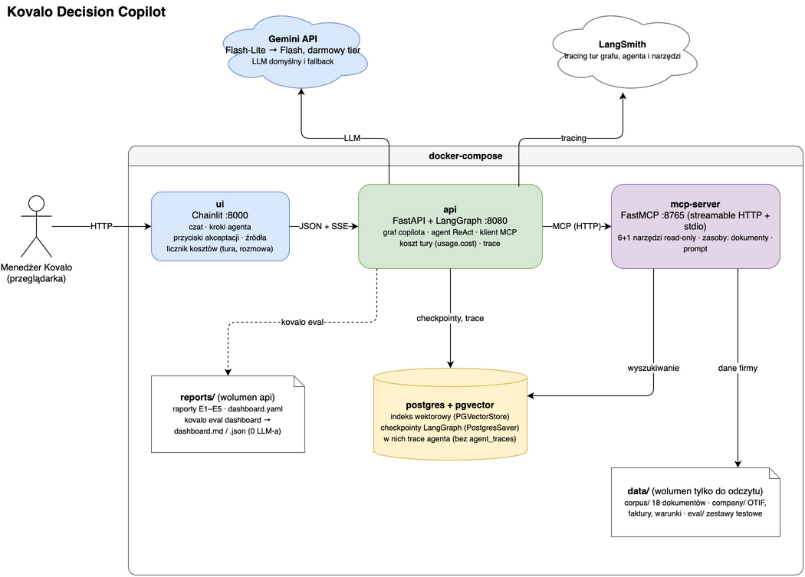

# Kovalo Decision Copilot

Asystent AI dla kadry zarządzającej fikcyjnej firmy **Kovalo Distribution**. Odpowiada na podstawie dokumentów firmy i podaje źródła, liczy na danych (OTIF, faktury, kary umowne), stosuje politykę rabatową i prowadzi workflow akceptacji z pauzami na decyzję człowieka. Narzędzia udostępnia przez MCP.

To projekt zaliczeniowy z przedmiotu **Technologie Generatywne (TEG)**. Łączy pięć miniprojektów z [wodecki/TEG_PL_Project_2026](https://github.com/wodecki/TEG_PL_Project_2026) w jedną aplikację.

**Stos:** LangChain 1.x · LangGraph 1.x · MCP (FastMCP) · Gemini Flash-Lite (darmowy tier) · fastembed · Postgres + pgvector · FastAPI · Chainlit · Docker.

Prompty do pokazu, po jednym na każdą ścieżkę grafu: [docs/demo/scenario.md](docs/demo/scenario.md).

## Architektura



## Co potrafi

- **Odpowiedzi z dokumentów firmy ze źródłami.** Umowy, polityki, notatki ze spotkań i raporty są zindeksowane w pgvector; odpowiedź cytuje dokumenty (`[POL-001]`), a gdy w nich czegoś nie ma, copilot to mówi zamiast zgadywać.
- **Obliczenia na danych firmy.** Agent ReAct wywołuje narzędzia przez serwer MCP (warunki umów, OTIF, faktury, kary umowne, warunek rozwiązania umowy). Liczby pochodzą z narzędzi, nie z modelu, a panel „Ścieżka dowodowa” pokazuje, skąd jest każda z nich.
- **Polityka rabatowa i workflow akceptacji.** Reguły polityki są w kodzie, nie w prompcie. Wniosek o rabat przechodzi przez sprawdzenie polityki, dopytanie o brakujące dane i pauzę na decyzję (Zatwierdź / Odrzuć / Anuluj); stan sprawy przeżywa restart dzięki checkpointom w Postgresie. Akceptacja jest symulowana: przyciski zastępują osoby zatwierdzające, nic nie trafia do CRM-u.
- **Pytania w trakcie sprawy.** W trakcie sprawy można zadać inne pytanie bez utraty wniosku; ponowne przesłanie tego samego wniosku nie tworzy nowej pauzy.
- **Koszty i obserwowalność.** Przy każdej turze z LLM-em panel „Koszt tury” (tokeny, koszt tury i suma rozmowy); każda tura w LangSmith jako drzewo: węzły grafu, wywołania Gemini, narzędzia MCP.
- **Narzędzia dla innych klientów MCP.** Ten sam serwer MCP (narzędzia, zasoby, prompt) działa z MCP Inspector, Claude Code i Claude Desktop.

## Szybki start

**Wymagania:** Docker Desktop z Compose v2 (około 6 GB miejsca na obrazy; obraz `api` zawiera model embeddingów), `make`, darmowy klucz Gemini z [Google AI Studio](https://aistudio.google.com/apikey) i darmowy klucz [LangSmith](https://smith.langchain.com) (Settings → API Keys). Do testów, dashboardu i serwera MCP na hoście: Python 3.12 i [uv](https://docs.astral.sh/uv/).

```bash
cp .env.example .env      # wpisz klucze: GOOGLE_API_KEY i LANGSMITH_API_KEY
make up                   # docker compose up -d --build: postgres, mcp-server, api, ui
make ingest               # pierwsze indeksowanie korpusu (jednorazowo, bez klucza)
open http://localhost:8000
```

- Pierwsze `make up` buduje obrazy i pobiera model `intfloat/multilingual-e5-large` (około 2,2 GB), więc trwa kilka do kilkunastu minut zależnie od łącza; kolejne starty to kilkadziesiąt sekund.
- Kluczy nie wpisuj nigdzie poza `.env` (plik jest w `.gitignore`). Bez klucza Gemini aplikacja wstaje, ale `/health` zgłasza `degraded`, a pytania kończą się błędem.
- Trace'y: [smith.langchain.com](https://smith.langchain.com) → Tracing → projekt `kovalo-copilot` (pojawia się po pierwszej turze). Konto w regionie EU wymaga w `.env` także `LANGSMITH_ENDPOINT=https://eu.api.smith.langchain.com`.
- Porty (tylko `127.0.0.1`): UI `8000`, API `8080` (zmiana: `API_PORT=8081 make up` albo wpis w `.env`), serwer MCP `8765`, Postgres `5432`. Stan usług: `curl http://localhost:8080/health`.
- Sprawdzenie klucza jednym wywołaniem: `make first-call`. Logi: `make logs` (jednej usługi: `make logs S=api`). Zatrzymanie: `make down`; wyczyszczenie bazy: `make db-reset`.

## Wyniki ewaluacji

Pełny widok: [reports/dashboard.md](reports/dashboard.md) (generowany z raportów, `make dashboard`); metryki i cele: [docs/06-evaluation.md](docs/06-evaluation.md).

| Etap | Co mierzy | Wynik (kurs → nasz) | Cel |
|---|---|---|---|
| E1 | wyszukiwanie i koszty (MP1) | hit@1 / hit@3 0,9 / 0,9 → 0,9 / 1,0; M03 trafione; koszt kursu $17,78 / $69,86 odtworzony | tak |
| E2 | odpowiedzi ze źródłami (MP2) | odpowiedzi 8/10 → 9/10, sędzia 8/8 → 9/9; poziomy 1–2 jak kurs | tak |
| E3 | workflow decyzyjny (MP3) | na żywo kierowanie 13/13 → 13/13, pola 11/11 → 10/11; odtworzenie 100% | tak |
| E4 | agent z narzędziami (MP4) | narzędzia 8/9 → 8/9, fakty 8/9 → 8/9; warunek rozwiązania umowy 67% / 0% → 100% / 100% | częściowo |
| E5 | końcowy asystent przez MCP (MP5) | na żywo 25/25 ścieżki, statusy, pauzy i trace, jak kurs; zgodność MCP 20/20 | tak |

E4 nie osiąga celu 9/9 z jednego powodu: w pytaniu B1 agent słusznie odmówił zatwierdzenia rabatu, ale nie wywołał `check_discount_policy` (opis w dashboardzie).

## Koszty

- **Projekt:** 0 USD (darmowy tier Gemini). Raporty i UI przeliczają te same tokeny po cennikach płatnych, żeby było wiadomo, ile kosztowałoby wdrożenie.
- **Scenariusz miesięczny kursu** (400 pytań dziennie, 21 dni roboczych): wyszukiwanie / cały korpus $17,78 / $69,86 po cenach referencyjnych kursu, $15,58 / $67,65 po cenach płatnego tieru Gemini.
- **Licznik w UI:** pod ostatnią wiadomością każdej tury z LLM-em jest linia kursywą z liczbą wywołań, modelem, tokenami wejścia i wyjścia, kosztem tury (cennik płatny Gemini / cennik kursu) i sumą rozmowy. Tura bez LLM-a (kliknięcie Zatwierdź) jej nie ma. Pytanie o karę przez agenta to 4–5 wywołań i około 0,44 centa po cenach płatnych Gemini (0,92 centa po cenach kursu).
- **Przebiegi ewaluacji:** od 0,42 do 2,49 centa na etap po cenach płatnych Gemini (tabela „Koszty” w dashboardzie).

## Testy i ewaluacja

| Polecenie | Co robi | Wywołania LLM-a |
|---|---|---|
| `make test` | testy jednostkowe i architektury (`uv run pytest`, bez `live` i `integration`) | 0 |
| `make test-integration` | testy z Postgresem z compose (wymaga `make up`) | 0 |
| `make lint` | `ruff check --fix`, `ruff format`, `mypy` | 0 |
| `make eval STAGE=e3` | ewaluacja etapu w obrazie `api` (`e1` … `e5`, opcje w `ARGS`, np. `ARGS="--transport http --backend pgvector"` dla E5); bez `--live` odtworzenie | 0 |
| `make eval-local STAGE=e5 ARGS="--live"` | przebieg na żywo na hoście (wymaga klucza w `.env`) | do kilkudziesięciu |
| `make dashboard` | `reports/dashboard.md` i `.json` z raportów (`make dashboard-check` tylko porównuje; uruchamiane w CI) | 0 |
| `make test-live T=tests/live/test_e5_live.py` | jeden test z prawdziwym LLM-em | kilka |

Zasada limitu: darmowy tier ma dzienny limit zapytań (Flash-Lite około 50 dziennie bez błędów 429 w naszych pomiarach, Flash 20), więc testy domyślnie nie wołają LLM-a, ewaluacje na żywo zapisują odpowiedzi w cache (powtórka `--live --cache-only` kosztuje 0 wywołań), a testy `live` uruchamiamy ręcznie, po jednym pliku.

## Dokumentacja

Zacznij od [docs/README.md](docs/README.md): przegląd, wymagania, architektura, stos, domena, ewaluacja, roadmapa, kontrakty etapów, ADR-y i sposób pracy z Claude Code (subagenci, skille, MCP).

## Struktura repozytorium

| Ścieżka | Zawartość |
|---|---|
| `src/kovalo/` | kod aplikacji (wiedza, RAG, polityka, workflow, agent, serwer i klient MCP, API, UI, ewaluacje) |
| `tests/` | testy: jednostkowe, architektury, integracyjne (compose), `live` (prawdziwy LLM) |
| `docs/` | dokumentacja projektu, kontrakty etapów, ADR-y, diagramy draw.io, scenariusz demo, materiały kursu |
| `reports/` | raporty ewaluacji E1–E5 (Markdown) i dashboard |
| `docker/`, `docker-compose.yml` | obrazy i usługi |
| `data/` | korpus 18 dokumentów, dane firmy, zestawy ewaluacyjne (z kursu, tylko do odczytu) |
| `reference/course/` | kod referencyjny kursu: szkielety kroków, testy, helpers (tylko do odczytu) |
| `.claude/` | subagenci i skille Claude Code |
| `.mcp.json` | serwery MCP: draw.io, dokumentacja LangChain, Context7 (budowa) oraz `kovalo` (nasz serwer, stdio) |

## Serwer MCP w innym kliencie

Serwer `kovalo` udostępnia 7 narzędzi tylko do odczytu, zasoby i prompt `supplier_review`. Dwa transporty:

- **Claude Code:** wpis `kovalo` w `.mcp.json` (stdio, `uv run --quiet kovalo-mcp --transport stdio --search memory`, wyszukiwanie w pamięci, bez Postgresa i klucza). Sprawdzenie: `claude mcp list`. Uruchamiaj Claude Code z katalogu projektu; wpis nie używa `--directory`.
- **Claude Desktop:** w `claude_desktop_config.json` ta sama komenda z bezwzględną ścieżką, np. `{"command": "uv", "args": ["run", "--quiet", "--directory", "/ścieżka/do/teg", "kovalo-mcp", "--transport", "stdio", "--search", "memory"]}`.
- **MCP Inspector, stdio:** `make mcp-inspector`; lista narzędzi z CLI: `make mcp-tools`.
- **MCP Inspector, HTTP:** po `make up` uruchom `make mcp-inspector-http` (Inspector od razu łączy się z `http://localhost:8765/mcp` przez Streamable HTTP). Port jest związany z `127.0.0.1`.

---

*Kovalo Distribution oraz wszystkie dokumenty, osoby i liczby w tym projekcie są fikcyjne (materiały kursu TEG).*
