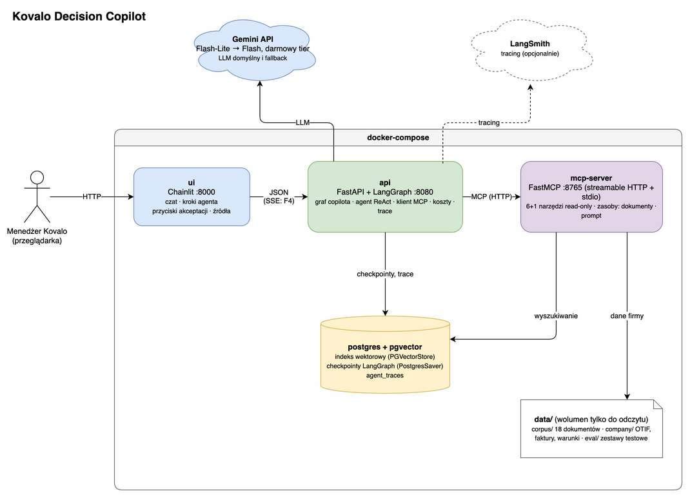
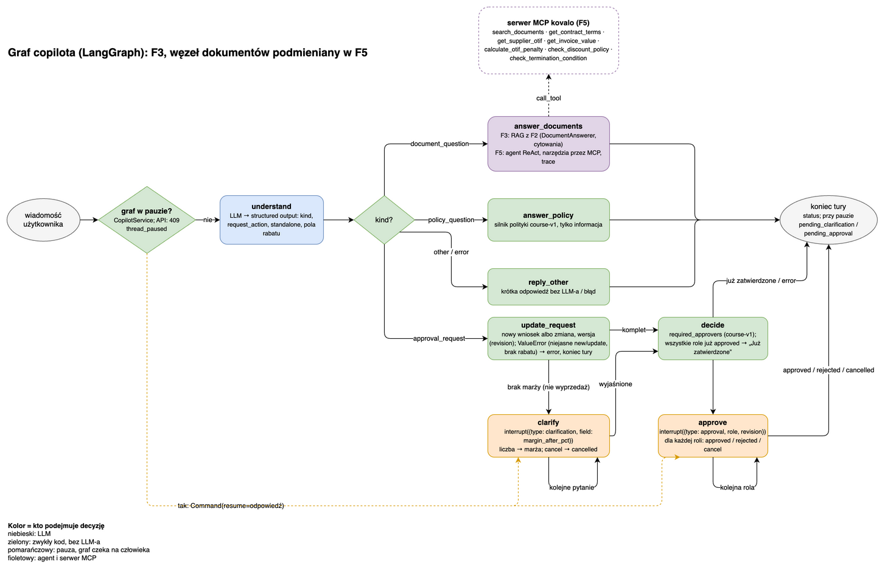
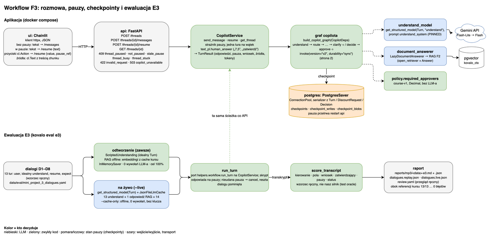
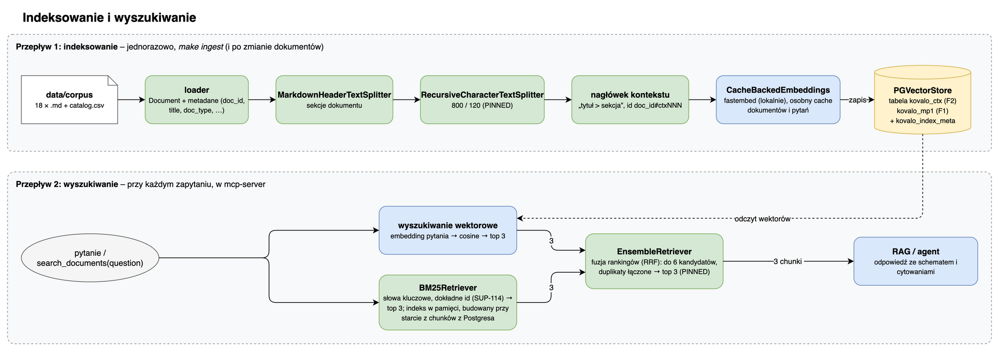
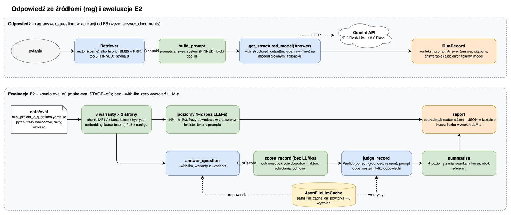

# 03. Architektura

Diagramy: [`architecture/kovalo-architecture.drawio`](architecture/kovalo-architecture.drawio). Plik ma pięć stron: kontenery, graf copilota, indeksowanie i wyszukiwanie, odpowiedź ze źródłami i ewaluacja E2, workflow F3 (API, UI, checkpointy, E3). Eksporty PNG leżą obok pliku.



## 1. Kontenery (docker-compose)

| Usługa | Obraz / technologia | Port | Odpowiedzialność |
|---|---|---|---|
| `ui` | Chainlit | 8000 | czat, kroki agenta, przyciski akceptacji, źródła; rozmawia tylko z `api` |
| `api` | FastAPI + LangGraph | 8080 (na hoście `API_PORT`) | graf copilota (`understand`, routing, workflow akceptacji, agent), checkpointy, koszty, trace |
| `mcp-server` | FastMCP (`mcp` SDK), streamable HTTP (`/mcp`) | 8765 | 6 narzędzi tylko do odczytu, zasoby (dokumenty), prompt; dostęp do indeksu i danych firmy |
| `postgres` | `pgvector/pgvector:pg16` | 5432 | indeks wektorowy (`langchain-postgres`, `PGVectorStore`: tabela na kolekcję), checkpointy LangGraph (`langgraph-checkpoint-postgres`), zapisy przebiegów |

Indeksowanie i ewaluacja to **nie osobne usługi**, tylko polecenia CLI (`kovalo ingest`, `kovalo eval`) uruchamiane jednorazowo w obrazie `api`: `make ingest` = `docker compose run --rm api kovalo ingest` (korpus → chunki MP1 i chunki z kontekstem → embeddingi → podmiana tabel `kovalo_mp1` i `kovalo_ctx`), `make eval STAGE=e2` = `docker compose run --rm api kovalo eval e2` (raport w `reports/`, montowanym jako wolumen).

Zewnętrznie: **Gemini API** (domyślny LLM, darmowy klucz z Google AI Studio), opcjonalnie **LangSmith** (tracing, darmowy plan dla jednej osoby).

Embeddingi liczymy **lokalnie** (fastembed, model ONNX wbudowany w obraz), więc ani indeksowanie, ani `mcp-server` nie potrzebują klucza.

```
Chainlit (ui) ──HTTP (JSON; SSE od F4)──> FastAPI (api) ──LangGraph──> Gemini API
                                 │   └──MCP streamable HTTP──> mcp-server ──> pgvector + data/company
                                 └──checkpointy / trace──> postgres
make ingest ──> data/corpus ──> chunki ──> fastembed ──> pgvector
```

## 2. Moduły Pythona (`src/kovalo/`)

```
src/kovalo/
  config.py          ustawienia: config.yaml (PINNED z kursu) + .env (pydantic-settings), get_settings()
  llm.py             fabryka modeli: init_chat_model(provider), rate limiter, fallback Flash-Lite → Flash (ADR-0006); fabryka embeddingów (F1); tryb offline z cache (F3)
  text_pl.py         liczby po polsku i odpowiedzi człowieka w pauzach (port helpers/text_pl.py kursu)
  health.py          wspólny format /health i sprawdzenia (Postgres, HTTP, klucz LLM-a)
  cli.py             polecenie `kovalo`: first-call, ingest, eval
  knowledge/         MP1/MP2: loader, chunking (zwykły i z kontekstem), embeddingi, vector store, BM25 (rank-bm25), Retriever (wektorowy | hybryda RRF)
  cost/              MP1: tokenizer o200k_base, scenariusz kosztów, licznik kosztów per tura
  rag/               MP2: schematy Answer/Verdict, rekord przebiegu, normalizacja odwołań, answer_question (model przez parametr)
  policy/            MP3: DiscountRequest, Decision, required_approvers (course-v1, Decimal; czysty kod, zero LLM-a)
  company/           MP4: odczyt danych firmy, kalkulator kary (Decimal, grosze)
  tools/             MP4: narzędzia LangChain (@tool) z kontraktami wyników i polem status
  agents/            MP4: agent ReAct (create_agent), supervisor (opcjonalnie), trace
  workflow/          MP3/MP5: Turn, understand_turn, update_request, stan, węzły, graf, checkpointer, CopilotService, fabryka
  mcp_server/        MP5: FastMCP, transport stdio + streamable-http
  mcp_client/        MP5: połączenie, limity czasu, klasy błędów, walidacja structuredContent
  eval/              MP1–MP5: retrieval (E1), rag (E2: 4 poziomy + sędzia), cache LLM-a na dysku, workflow (E3: odtworzenie + na żywo), trace (5 testów), assistant
  api/               FastAPI: router /threads nad CopilotService, schematy wejścia i błędów, dostawca serwisu (lifespan)
  ui/                Chainlit (app.py) zamontowany w FastAPI (server.py, /health); klient HTTP do api, renderowanie odpowiedzi, pauz i źródeł
```

Punkty wejścia: `kovalo` (CLI), `kovalo-api`, `kovalo-ui`, `kovalo-mcp`. Kontrakty modułów fundamentu (`config`, `llm`, `health`, `cli`) opisuje [contracts/f0.md](contracts/f0.md), modułów wiedzy i kosztów (`knowledge`, `cost`, `eval` E1) [contracts/f1.md](contracts/f1.md), odpowiedzi ze źródłami i E2 (`rag`, `knowledge` z hybrydą, `eval/rag`) [contracts/f2.md](contracts/f2.md), a workflow, API, UI i E3 (`policy`, `workflow`, `api`, `ui`, `eval/workflow`) [contracts/f3.md](contracts/f3.md).

Zasady zależności (sprawdzane w review):
- `policy/`, `company/`, `cost/` nie importują LangChaina ani niczego z LLM-em: to deterministyczny rdzeń.
- `tools/` to cienkie nakładki na `knowledge/`, `company/`, `policy/`. `mcp_server/` to cienkie nakładki na `tools/`.
- `workflow/` nie zna transportu narzędzi: dostaje listę narzędzi (bezpośrednich albo z MCP) przez parametr.
- `api/` i `ui/` nie zawierają logiki biznesowej. `ui/` nie importuje `llm`, `workflow`, `agents`, `tools`, `knowledge`, `rag`: rozmawia z `api` przez HTTP.
- Tylko `llm.py` importuje integracje dostawców (`langchain_google_genai`, `langchain_openai`) i `init_chat_model`. `config.py` i `health.py` nie importują LangChaina.
- `fastembed` importuje tylko `knowledge/embeddings.py`, `langchain_postgres` tylko `knowledge/pgvector.py`, `tiktoken` tylko `cost/tokens.py`. `knowledge/` i `cost/` nie importują `llm`: model embeddingów dostają przez parametr z `llm.get_embeddings()` ([contracts/f1.md §2.3](contracts/f1.md)).
- `rank_bm25` importuje tylko `knowledge/lexical.py`, `langchain_text_splitters` tylko `knowledge/chunking.py`; `langchain_community` nigdzie ([ADR-0008](adr/0008-rag-hybrid-e2.md)).
- Generacja RAG żyje w `rag/`: `answer_question` dostaje `Retriever` i model przez parametr, a `kovalo.llm` importuje tylko `rag/factory.py`. `knowledge/` nie importuje `rag/`; `rag/` nie importuje `eval/`, `workflow/`, `api/`, `ui/`. `llm.py` dostaje cache LLM-a parametrem i nie importuje `eval/` ([contracts/f2.md §2.3](contracts/f2.md)).
- `policy/` importuje tylko bibliotekę standardową, `pydantic`, `kovalo.config`, `kovalo.text_pl`. `workflow/` dostaje model `understand` i `DocumentAnswerer` przez `CopilotDeps`; `kovalo.llm`, `kovalo.rag.factory` i `kovalo.knowledge` importuje tylko `workflow/factory.py`, a `langgraph.checkpoint.postgres` i `psycopg_pool` tylko `workflow/checkpoint.py`. `interrupt()` wywołują tylko węzły w `workflow/graph.py` ([contracts/f3.md §2.3](contracts/f3.md)).
- `api/` woła wyłącznie `workflow.CopilotService` (bez `langgraph`, `kovalo.llm`, `kovalo.policy`); `ui/` ma własne modele widoku i nie importuje `kovalo.api` ([ADR-0010](adr/0010-api-ui-f3.md)).
- Nazwy modeli (czatu i embeddingów) są tylko w `config.yaml` (model embeddingów także w `ARG` Dockerfile, pilnowanym testem). Część zasad sprawdza test `tests/architecture/test_dependencies.py`.

## 3. Graf copilota (LangGraph)



```
START → understand ─┬─ document_question ─> answer_documents   (F3: RAG z F2; F5: agent ReAct, narzędzia przez MCP)
                    ├─ policy_question   ─> answer_policy      (silnik polityki, tylko informacja, bez pauzy)
                    ├─ other / error     ─> reply_other
                    └─ approval_request  ─> update_request ─┬─(ValueError: niejasne new|update, brak rabatu)─> END (error)
                                                            ├─(brak marży, nie wyprzedaż)─> clarify ⟲ (interrupt)
                                                            └─> decide ─┬─(już zatwierdzone)─> END
                                                                        └─> approve ⟲ (interrupt, rola po roli) ─> END
```

- **Stan** (`CopilotState`, TypedDict, 1:1 z kursu): `messages` (reducer `add_messages`), `turn` (`Turn`: kind, request_action, standalone, pola rabatu), `request` (`DiscountRequest` z `revision`), `decision` (`Decision`), `approvals` (rola → `approved`/`rejected` dla bieżącej wersji), `status`, `record` (`RunRecord` jako słownik), `error`; NASZE: `calls` (wywołania LLM-a w turze: model, tokeny, czas).
- **Checkpointer:** `PostgresSaver` na `psycopg_pool.ConnectionPool` z serializerem znającym `Turn`, `DiscountRequest`, `Decision`; w testach i E3 `InMemorySaver` z tym samym serializerem. `thread_id` = UUID rozmowy z `POST /threads`. Pauza przetrwa restart kontenera ([ADR-0009](adr/0009-workflow-f3.md)).
- **Pauzy:** ładunki 1:1 z kursu: `interrupt({"type": "clarification", "field": "margin_after_pct", "question": ...})` i `interrupt({"type": "approval", "role": ..., "revision": ..., "approvers": [...], "request": {...}})`. Jedno `interrupt()` na wywołanie węzła; zła odpowiedź wraca krawędzią do tego samego węzła. Wznowienie: `Command(resume=liczba | "approved" | "rejected" | "cancel")`; polskie słowa i „7,5” zamienia `text_pl.human_answer` w serwisie.
- **Serwis** `workflow.CopilotService` (`send_message`, `resume`, `get_thread`) to jedyne wejście do grafu dla API i E3: strażnik pauzy (nowa wiadomość w pauzie → `ThreadPausedError`, w API 409), jedna tura naraz na wątek, `TurnResult` (odpowiedzi tury, pauza, wniosek, źródła, tokeny).
- **Węzeł `answer_documents`** dostaje `DocumentAnswerer` przez `CopilotDeps`: w F3 to RAG z F2 (`rag.build_document_answerer`, [contracts/f2.md §7.4](contracts/f2.md)), w F5 agent z narzędziami MCP. Obie wersje używają tej samej fabryki grafu.



## 4. Kontrakty

### Wynik narzędzia (MP4/MP5)

Każde narzędzie zwraca słownik z polem `status` (`ok / no_data / unknown_supplier / not_applicable / out_of_scope / invalid_request`) i polami zależnymi od narzędzia. Przez MCP wynik idzie jako `structuredContent` (ten sam słownik) + tekst. Klient waliduje go modelem Pydantic, zanim użyje wartości domyślnych.

### API

Kontrakt F3: [contracts/f3.md §8](contracts/f3.md), decyzje: [ADR-0010](adr/0010-api-ui-f3.md). Każdy błąd ma ciało `ApiError {error, detail, pending}` (także walidacja: 422 `invalid_request`; nieoczekiwany: 500 `internal_error`). W F3 odpowiedzi to JSON (`TurnResult`); strumień SSE (`token`, `tool_start`, `tool_end`, `interrupt`, `final` z `TurnResult`) dochodzi w F4.

| Metoda | Ścieżka | Ciało / wynik | Od |
|---|---|---|---|
| POST | `/threads` | → 201 `{thread_id}` (UUID) | F3 |
| POST | `/threads/{id}/messages` | `{text}` → `TurnResult`; 409 `thread_paused` (z ładunkiem pauzy), `thread_busy`, `thread_stuck`; 422 `invalid_request`; 503 `copilot_unavailable` | F3 (SSE: F4) |
| POST | `/threads/{id}/resume` | `{value}` (liczba / `approved` / `rejected` / `cancel`) albo `{text}` („7,5”, „zatwierdź”), opcjonalnie `pause_ref` → `TurnResult`; 409 `not_paused`, `stale_pause` | F3 |
| GET | `/threads/{id}` | `ThreadState`: status, aktywna pauza, wniosek, decyzja, akceptacje, wiadomości | F3 |
| GET | `/threads/{id}/trace` | ścieżka dowodowa ostatniej tury | F4 |
| GET | `/health` | `HealthReport`: `ok` / `degraded` (200) / `error` (503); sprawdzenia Postgresa (krytyczne), MCP i klucza LLM-a bez wywołania modelu ([contracts/f0.md §6](contracts/f0.md)) | F0 |

## 5. Przepływ indeksowania



`catalog.csv` + `corpus/*.md` → `Document` z metadanymi → `MarkdownHeaderTextSplitter` → `RecursiveCharacterTextSplitter(800/120)` → nagłówek `<tytuł> > <sekcja>` (87 chunków, id `<doc_id>#ctxNNN`) → `CacheBackedEmbeddings(fastembed)` (osobny cache dokumentów i pytań) → `PGVectorStore`, tabela `kovalo_ctx`. Obok, do porównań E1/E2, chunki MP1 (47) w `kovalo_mp1`. `kovalo ingest` buduje każdą tabelę obok i podmienia ją w jednej transakcji, a model, wymiar i liczbę chunków zapisuje w `kovalo_index_meta` ([ADR-0007](adr/0007-knowledge-index-f1.md)).

Wyszukiwanie (`knowledge.Retriever`): tryb `retrieval.mode` = `vector` (cosine, top 3) albo `hybrid`: top 10 z wektorów i top 10 z BM25 (`rank-bm25`, indeks w pamięci budowany przy starcie z korpusu, zgodność sprawdzana z `kovalo_index_meta.n_chunks`) → ważona Reciprocal Rank Fusion → top 3 ([ADR-0008](adr/0008-rag-hybrid-e2.md)). Domyślnie `vector`: w E2 z e5 hybryda nie dała przewagi (hit@1 9/10 wobec 10/10, reszta remis), a `hybrid` zostaje do włączenia w configu.

## 5a. Odpowiedź ze źródłami i E2



`rag.answer_question`: pytanie → `Retriever` (top 3) → `build_prompt(answer_system)` → `get_structured_model(Answer)` (Gemini z fallbackiem, `include_raw=True`) → `RunRecord` (kontekst, prompt, `Answer` albo błąd, tokeny, model). Ewaluacja E2 ocenia rekord bez LLM-a (`score_record`: dowody, fakty, odwołania, odmowy) i sędzią (`judge_record`, prompt `judge_system`), a odpowiedzi modeli trzyma w cache na dysku (`paths.llm_cache_dir`), więc powtórny przebieg nie zużywa limitu ([contracts/f2.md §8](contracts/f2.md)).

## 6. Obserwowalność i koszty

- Licznik tokenów i kosztów per tura z `usage_metadata` (przeliczany po cenach referencyjnych z configu i po faktycznych cenach dostawcy; free tier = 0 USD).
- Trace agenta w Postgresie (`agent_traces`), widoczny w UI i przez `GET /threads/{id}/trace`.
- Opcjonalnie LangSmith (`LANGSMITH_TRACING=true`).
